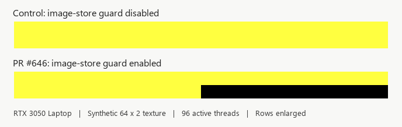

# Partial DispatchX writes to a 2D texture

On the RTX 3050 Laptop, a synthetic spilled wave64 compute shader running on wave32 wrote RGBA32_FLOAT texels to a 64 by 2 UAV. Two 64-thread groups wrote separate rows. The active-wave count and part of a wave OR are encoded in two channels so the test checks reduction results as well as the write footprint.

At PR #646 head 36a2257b integrated onto 504db0e, all 33,280 channel comparisons passed across 65 dispatches (limits 65 through 128, and 0 meaning uncapped). In the negative control only the image instruction's call to effect_guard was replaced with guard, leaving its ordinary EXEC predicate and all other translation logic intact. At limit 96 this caused precisely the last 32 texels of the second row to be overwritten. All 96 other texels were identical. The comparison below maps actual GPU readback RGB values to 8-bit display colour, enlarging the rows. Numeric checks used the original four 32-bit channels.



Apply the adjacent dispatchx-texture.patch to PR head 36a2257b. Run on Windows with a wave32 adapter:

```powershell
cargo test --locked -p victory-shader --lib partial_dispatch_preserves_texture_columns -- --nocapture
```

Set VICTORY_TEST_TEXTURE_READBACK to an output filename to save the limit-96 frame as tightly packed little-endian RGBA32_FLOAT. The test requires hardware pipeline creation and reads back all texels. This verifies an X-axis partial group using a float texture. Lighting, frame rate and gameplay were not measured. AI-assisted.
